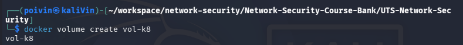
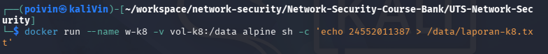
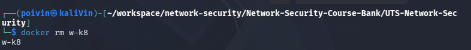
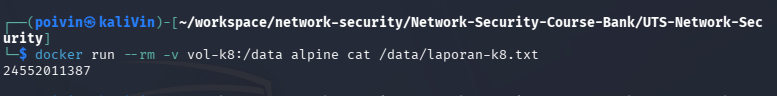
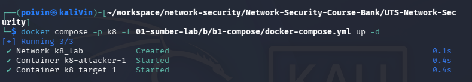
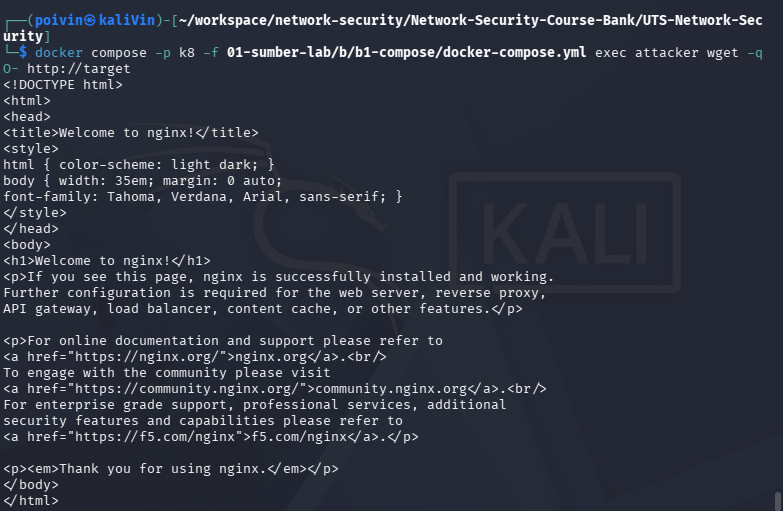
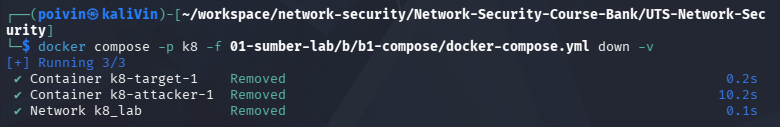

# Docker dan Volume — Kasus 8

**Pertemuan:** 1

## Tujuan

Membuktikan bahwa data pada Docker Volume tetap ada walaupun container yang menulisnya sudah dihapus, serta menjalankan dua container (attacker dan target) dengan Docker Compose yang saling berkomunikasi lewat jaringan internal.

## Langkah dan Perintah

```bash
docker volume create vol-k8
docker run --name w-k8 -v vol-k8:/data alpine sh -c 'echo 24552011387 > /data/laporan-k8.txt'
docker rm w-k8
docker run --rm -v vol-k8:/data alpine cat /data/laporan-k8.txt
docker compose -p k8 -f 01-sumber-lab/b/b1-compose/docker-compose.yml up -d
docker compose -p k8 -f 01-sumber-lab/b/b1-compose/docker-compose.yml exec attacker wget -qO- http://target
docker compose -p k8 -f 01-sumber-lab/b/b1-compose/docker-compose.yml down -v
```

- `docker volume create vol-k8` membuat volume bernama `vol-k8` sebagai penyimpanan yang terpisah dari siklus hidup container.
- `docker run --name w-k8 -v vol-k8:/data alpine sh -c 'echo ... > /data/laporan-k8.txt'` menjalankan container Alpine, memasang volume ke `/data`, lalu menulis NIM ke `laporan-k8.txt`.
- `docker rm w-k8` menghapus container penulis. Yang dihapus hanya container-nya, bukan volume.
- `docker run --rm -v vol-k8:/data alpine cat /data/laporan-k8.txt` memakai container baru untuk membaca file yang sama dari volume.
- `docker compose ... up -d` menjalankan container `attacker` dan `target` pada jaringan `k8_lab`.
- `exec attacker wget -qO- http://target` mengambil halaman web target dari container attacker memakai nama layanan `target`.
- `docker compose ... down -v` menghentikan dan menghapus container, jaringan, serta volume yang dibuat Compose.

## Bukti Screenshot

**Screenshot 1:** Pembuatan volume `vol-k8`.



**Screenshot 2:** Container `w-k8` menulis NIM ke `/data/laporan-k8.txt` pada volume.



**Screenshot 3:** Container penulis `w-k8` dihapus.



**Screenshot 4:** Container baru membaca file dari volume dan menampilkan NIM `24552011387`.



**Screenshot 5:** Docker Compose membuat jaringan `k8_lab` serta container `k8-attacker-1` dan `k8-target-1`.



**Screenshot 6:** Container attacker berhasil mengambil halaman `Welcome to nginx!` dari target.



**Screenshot 7:** Compose `down -v` menghapus kedua container dan jaringan.



## Hasil Pengujian

1. Volume `vol-k8` berhasil dibuat dan file `laporan-k8.txt` berhasil ditulis.
2. Setelah container `w-k8` dihapus, container baru tetap bisa membaca isi file dan menampilkan `24552011387`. Data bertahan karena tersimpan di volume.
3. Docker Compose membuat jaringan `k8_lab` dan dua container (`k8-attacker-1`, `k8-target-1`) dalam status Started.
4. Container attacker berhasil mengakses `http://target` dan menerima halaman default Nginx, sehingga komunikasi antarcontainer berjalan.
5. Perintah `down -v` menghapus kedua container dan jaringan `k8_lab`.

## Kesimpulan

Docker Volume memisahkan penyimpanan data dari container sehingga data tetap ada setelah container dihapus. Docker Compose memudahkan pengelolaan beberapa container sekaligus dan memungkinkan komunikasi antarcontainer lewat nama layanan.
