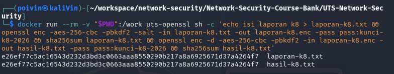
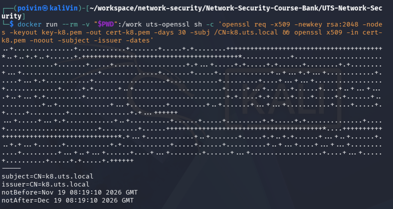

# Kriptografi — Kasus 8

**Pertemuan:** 2

## Tujuan

Menguji hash SHA-256, enkripsi dan dekripsi AES-256-CBC, serta pembuatan sertifikat digital self-signed menggunakan OpenSSL.

## Langkah dan Perintah

```bash
docker run --rm -v "$PWD":/work uts-openssl sh -c 'echo isi laporan k8 > laporan-k8.txt && openssl enc -aes-256-cbc -pbkdf2 -salt -in laporan-k8.txt -out laporan-k8.enc -pass pass:kunci-k8-2026 && sha256sum laporan-k8.txt && openssl enc -d -aes-256-cbc -pbkdf2 -in laporan-k8.enc -out hasil-k8.txt -pass pass:kunci-k8-2026 && sha256sum hasil-k8.txt'

docker run --rm -v "$PWD":/work uts-openssl sh -c 'openssl req -x509 -newkey rsa:2048 -nodes -keyout key-k8.pem -out cert-k8.pem -days 30 -subj /CN=k8.uts.local && openssl x509 -in cert-k8.pem -noout -subject -issuer -dates'
```

- `openssl enc -aes-256-cbc -pbkdf2 -salt` mengenkripsi `laporan-k8.txt` menjadi `laporan-k8.enc` dengan AES-256 mode CBC, derivasi kunci PBKDF2, dan salt acak.
- `sha256sum laporan-k8.txt` menghitung hash file asli sebagai sidik jari integritas.
- `openssl enc -d ...` mendekripsi `laporan-k8.enc` menjadi `hasil-k8.txt`, lalu `sha256sum hasil-k8.txt` dihitung untuk dibandingkan.
- `openssl req -x509 -newkey rsa:2048 -nodes` membuat kunci privat RSA 2048-bit dan sertifikat self-signed `cert-k8.pem` berlaku 30 hari dengan `CN=k8.uts.local`.
- `openssl x509 -noout -subject -issuer -dates` menampilkan Subject, Issuer, serta masa berlaku sertifikat.

## Bukti Screenshot

**Screenshot 1:** Enkripsi, dekripsi, dan dua hash SHA-256.



**Screenshot 2:** Pembuatan sertifikat dan pemeriksaan Subject, Issuer, serta masa berlaku.



## Hasil Pengujian

1. Hash SHA-256 file asli (`laporan-k8.txt`) dan hasil dekripsi (`hasil-k8.txt`) sama persis: `e26ef77c5ac16543d232d3bd3c0663aaa8550290b217a8a6925671d37a4264f7`. Artinya isi file kembali utuh setelah enkripsi dan dekripsi.
2. Sertifikat berhasil dibuat. `subject=CN=k8.uts.local` dan `issuer=CN=k8.uts.local`; keduanya sama karena sertifikat ditandatangani sendiri.
3. Masa berlaku: `notBefore=Nov 19 08:19:10 2026 GMT` sampai `notAfter=Dec 19 08:19:10 2026 GMT`, yaitu 30 hari.

## Kesimpulan

SHA-256 dapat dipakai untuk memeriksa integritas file, AES untuk menjaga kerahasiaan data, dan sertifikat digital untuk menyatakan identitas. Sertifikat self-signed cukup untuk lab, tetapi tidak dipercaya publik karena tidak diterbitkan oleh otoritas sertifikat (CA).
