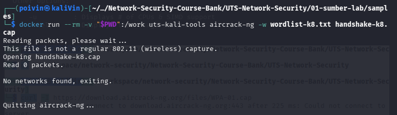

# Analisis Handshake WPA2 — Kasus 8

**Pertemuan:** 4

## Tujuan

Menganalisis file capture handshake WPA2 dengan aircrack-ng menggunakan wordlist yang disediakan, serta memahami empat langkah four-way handshake.

## Langkah dan Perintah

```bash
docker run --rm -v "$PWD":/work uts-kali-tools aircrack-ng -w wordlist-k8.txt handshake-k8.cap
```

- `-v "$PWD":/work` memasang folder kerja (berisi `wordlist-k8.txt` dan `handshake-k8.cap`) ke dalam container.
- `aircrack-ng -w wordlist-k8.txt handshake-k8.cap` membaca file capture dan mencoba setiap kata sandi di wordlist terhadap handshake yang ditemukan.

## Penjelasan Four-Way Handshake

Four-way handshake membuktikan bahwa client dan access point (AP) sama-sama mengetahui PSK tanpa mengirim PSK itu sendiri.

1. **Message 1 (AP ke client):** AP mengirim ANonce (angka acak dari AP).
2. **Message 2 (client ke AP):** Client mengirim SNonce, lalu menurunkan PTK dari PSK, ANonce, SNonce, dan alamat MAC kedua pihak. Pesan ini disertai MIC.
3. **Message 3 (AP ke client):** AP menurunkan PTK yang sama, memverifikasi MIC, lalu mengirim GTK yang terenkripsi beserta MIC.
4. **Message 4 (client ke AP):** Client mengonfirmasi bahwa kunci sudah terpasang.

Penyerang yang menangkap handshake dapat mencoba menebak PSK secara offline dengan menurunkan PTK dari setiap kandidat kata sandi dan mencocokkan MIC. Karena itu kata sandi yang panjang dan acak sangat penting.

## Bukti Screenshot

**Screenshot 1:** Keluaran `aircrack-ng` pada file `handshake-k8.cap`.



## Hasil Pengujian

1. `aircrack-ng` menampilkan `This file is not a regular 802.11 (wireless) capture`, `Read 0 packets`, dan `No networks found, exiting`.
2. Karena tidak ada jaringan atau handshake yang terbaca dari file tersebut, tidak ada tahap pencocokan kata sandi yang dijalankan. Pesan `KEY FOUND` maupun `KEY NOT FOUND` tidak muncul.
3. Dengan demikian, kata sandi WPA2 **tidak** berhasil ditemukan pada bukti ini, dan hasil tersebut tidak dapat dianggap sebagai kegagalan wordlist karena file capture memang tidak terbaca sebagai capture 802.11.

## Kesimpulan

Perintah `aircrack-ng` berjalan, tetapi file `handshake-k8.cap` yang digunakan tidak terbaca sebagai capture 802.11 sehingga tidak ada handshake yang dapat dianalisis. Praktikum ini tetap menunjukkan syarat analisis handshake: file capture harus berisi paket WPA yang valid. Penjelasan four-way handshake di atas melengkapi pemahaman konsepnya.
