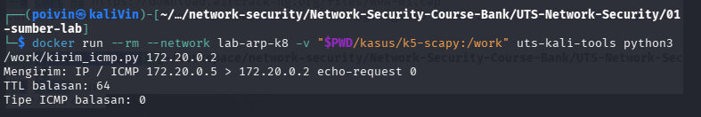

# ICMP dengan Scapy — Kasus 8

**Pertemuan:** 5

## Tujuan

Mengirim paket ICMP echo request memakai Scapy ke container korban lalu membaca TTL dan tipe ICMP pada balasan.

## Langkah dan Perintah

```bash
docker run --rm --network lab-arp-k8 -v "$PWD/kasus/k5-scapy:/work" uts-kali-tools python3 /work/kirim_icmp.py 172.20.0.2
```

- `--network lab-arp-k8` menghubungkan container sementara ke jaringan yang sama dengan korban.
- `-v "$PWD/kasus/k5-scapy:/work"` memasang folder skrip `kirim_icmp.py` ke dalam container.
- Skrip membuat paket `IP(dst=target)/ICMP()` lalu mengirimnya dengan `sr1()` dan membaca balasan pertama.
- Argumen `172.20.0.2` adalah IP `korban-k8` dari Tugas 3.

## Penjelasan Smurf Attack

Smurf attack adalah serangan DDoS yang memanfaatkan ICMP echo request ke alamat broadcast dengan IP sumber dipalsukan sebagai alamat korban. Semua host pada jaringan broadcast tersebut membalas ke korban sehingga trafik ICMP berlipat dan korban kewalahan. Pencegahan yang umum: menonaktifkan balasan terhadap broadcast ICMP pada router dan host, serta menerapkan filter anti-spoofing.

## Bukti Screenshot

**Screenshot 1:** Keluaran skrip Scapy: paket yang dikirim, TTL balasan, dan tipe ICMP balasan.



## Hasil Pengujian

1. Paket yang dikirim: `IP / ICMP 172.20.0.5 > 172.20.0.2 echo-request 0`. Alamat sumber `172.20.0.5` adalah IP container sementara yang menjalankan skrip.
2. TTL balasan: `64`. Nilai ini umum untuk sistem Linux, yang mengindikasikan korban adalah host Linux yang berjarak satu lompatan.
3. Tipe ICMP balasan: `0`, yaitu **echo reply**. Ini berarti korban aktif dan merespons ping.

## Kesimpulan

Scapy memungkinkan pembuatan dan pengiriman paket ICMP secara terprogram. Balasan bertipe 0 dengan TTL 64 membuktikan host target aktif. Mekanisme balasan ICMP inilah yang disalahgunakan pada smurf attack.
