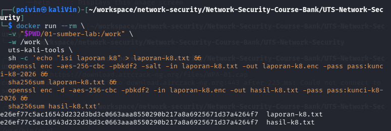
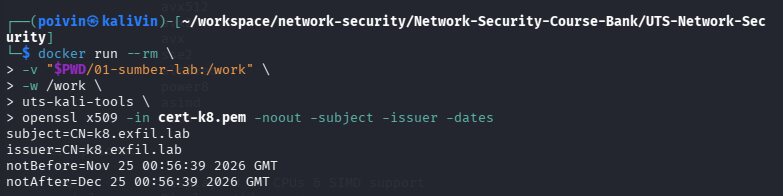

# Kriptografi — Kasus 8

**Pertemuan:** 2

## Tujuan

Menguji hash SHA-256, enkripsi dan dekripsi AES-256-CBC, serta pemeriksaan sertifikat digital self-signed menggunakan OpenSSL.

## Langkah dan Perintah

```bash
docker run --rm -v "$PWD/01-sumber-lab":/work -w /work uts-kali-tools sh -c 'echo "isi laporan k8" > laporan-k8.txt && openssl enc -aes-256-cbc -pbkdf2 -salt -in laporan-k8.txt -out laporan-k8.enc -pass pass:kunci-k8-2026 && sha256sum laporan-k8.txt && openssl enc -d -aes-256-cbc -pbkdf2 -in laporan-k8.enc -out hasil-k8.txt -pass pass:kunci-k8-2026 && sha256sum hasil-k8.txt'

docker run --rm -v "$PWD/01-sumber-lab":/work -w /work uts-kali-tools openssl x509 -in cert-k8.pem -noout -subject -issuer -dates
```

- `openssl enc -aes-256-cbc -pbkdf2 -salt` mengenkripsi `laporan-k8.txt` menjadi `laporan-k8.enc` dengan AES-256 mode CBC, derivasi kunci PBKDF2, dan salt acak.
- `sha256sum laporan-k8.txt` menghitung hash file asli sebagai sidik jari integritas.
- `openssl enc -d ...` mendekripsi `laporan-k8.enc` menjadi `hasil-k8.txt`, lalu `sha256sum hasil-k8.txt` dihitung untuk dibandingkan.
- `openssl x509 -in cert-k8.pem -noout -subject -issuer -dates` memeriksa sertifikat self-signed `cert-k8.pem` (CN `k8.exfil.lab`) dan menampilkan Subject, Issuer, serta masa berlaku 30 hari.

## Bukti Screenshot

**Screenshot 1:** Enkripsi, dekripsi, dan dua hash SHA-256 (hasilnya identik).



**Screenshot 2:** Pemeriksaan sertifikat `cert-k8.pem`: Subject, Issuer, serta masa berlaku.



## Hasil Pengujian

1. **Hash SHA-256.** Hash file asli `laporan-k8.txt` dan file hasil dekripsi `hasil-k8.txt` bernilai sama, yaitu `e26ef77c5ac16543d232d3bd3c0663aaa8550290b217a8a6925671d37a4264f7` (Screenshot 1). Isi file kembali utuh setelah dienkripsi dengan AES-256-CBC lalu didekripsi.
2. **Sertifikat digital.** Pemeriksaan `cert-k8.pem` menunjukkan `subject=CN=k8.exfil.lab` dan `issuer=CN=k8.exfil.lab` (Screenshot 2). Subject dan Issuer sama karena sertifikat ditandatangani sendiri (self-signed), tanpa Certificate Authority (CA).
3. **Masa berlaku.** `notBefore=Nov 25 00:56:39 2026 GMT` dan `notAfter=Dec 25 00:56:39 2026 GMT`, sehingga sertifikat berlaku 30 hari.

## Kesimpulan

AES-256-CBC berhasil menjaga kerahasiaan data, dan kesamaan dua hash SHA-256 membuktikan integritas file tetap terjaga setelah enkripsi dan dekripsi. Sertifikat self-signed dengan CN `k8.exfil.lab` berhasil dibuat dan valid selama 30 hari. Sertifikat jenis ini cukup untuk lab, tetapi tidak otomatis dipercaya publik karena tidak diterbitkan oleh CA.
